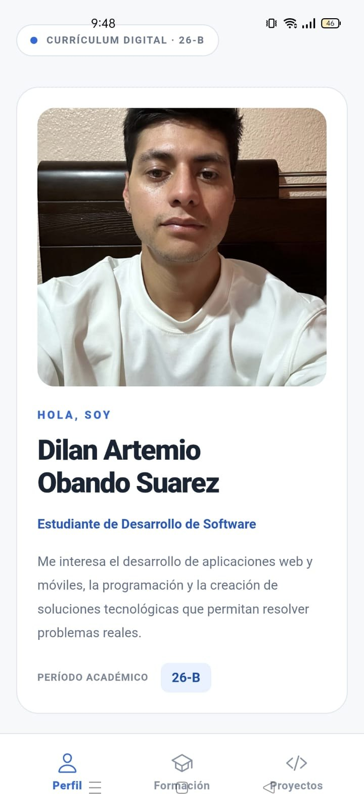
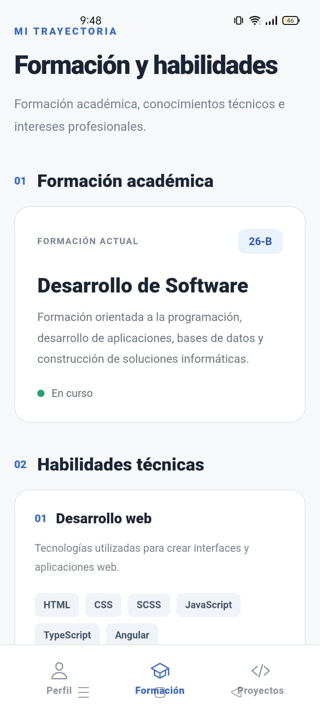
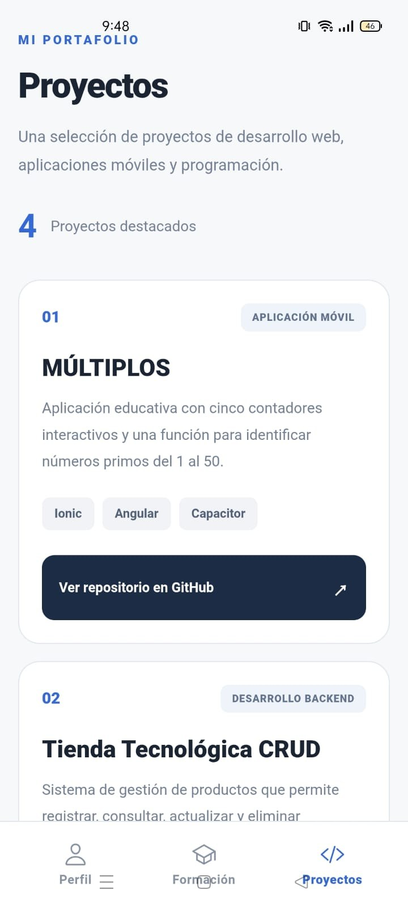
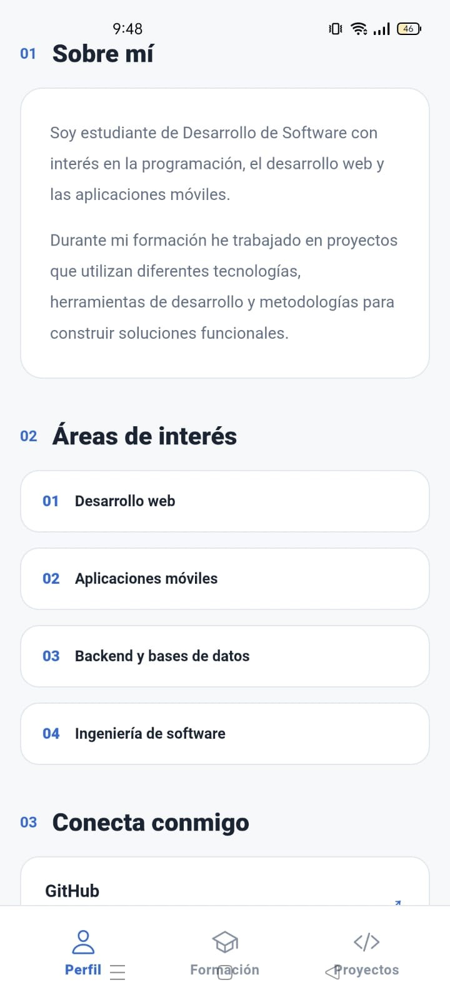
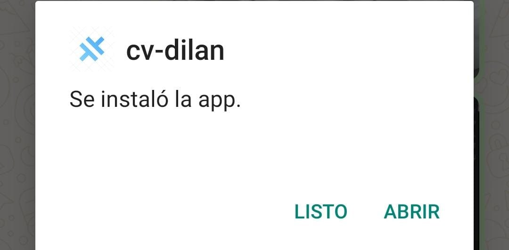
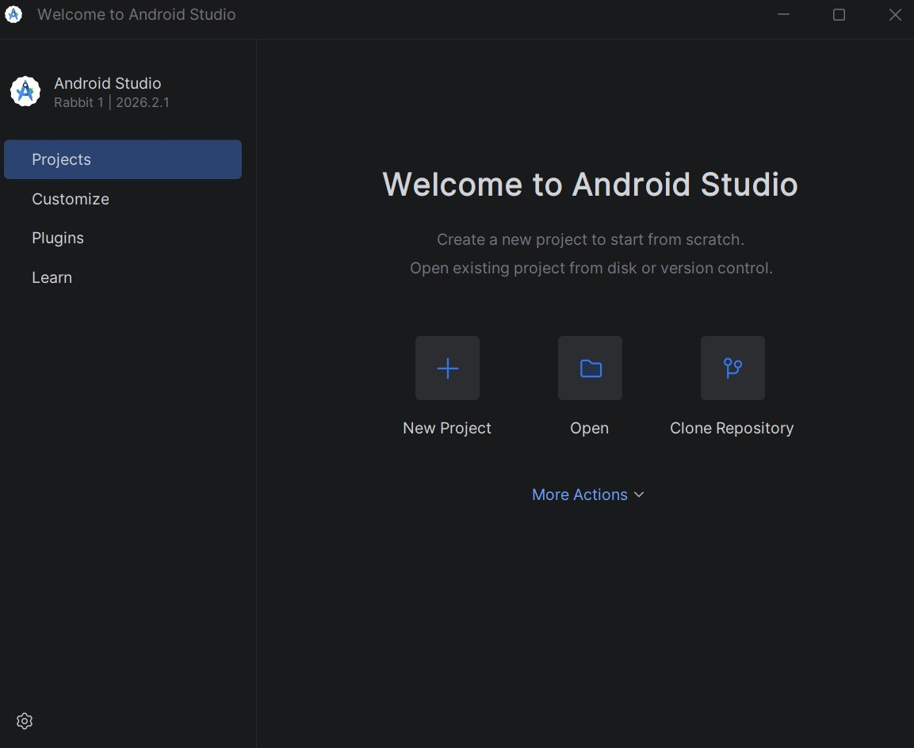

# CV digital — Ionic + Angular

**Deber 1 · Desarrollo de Software · Período académico 26-B**

Aplicación móvil de currículum vitae desarrollada con **Ionic, Angular y la plantilla Tabs**. Presenta el perfil académico, las habilidades técnicas y una selección de proyectos de software en una interfaz adaptable a dispositivos móviles.

**Estudiante:** Dilan Artemio Obando Suarez  
**Estado del proyecto:** Implementado y probado en navegador y en un teléfono Android.

## Vista previa

<table>
  <tr>
    <td align="center"><strong>Perfil</strong></td>
    <td align="center"><strong>Formación</strong></td>
    <td align="center"><strong>Proyectos</strong></td>
  </tr>
  <tr>
    <td align="center"></td>
    <td align="center"></td>
    <td align="center"></td>
  </tr>
</table>

### Funcionalidades

| Pestaña | Contenido |
| --- | --- |
| **Perfil** | Presentación personal, fotografía, áreas de interés y enlaces profesionales. |
| **Formación** | Carrera de Desarrollo de Software, período 26-B, habilidades técnicas e idiomas español e inglés. |
| **Proyectos** | Portafolio de proyectos con descripción, tecnologías y enlaces a los repositorios de GitHub. |

La navegación entre secciones se realiza mediante la barra inferior de **Ionic Tabs**.

### Evidencia de funcionamiento

**Detalle del perfil**  


**Instalación del APK en Android**  


## Tecnologías y herramientas

| Herramienta | Uso |
| --- | --- |
| Node.js y npm | Entorno de ejecución y gestión de dependencias. |
| Ionic | Componentes de interfaz y plantilla Tabs. |
| Angular y TypeScript | Estructura, componentes y lógica de la aplicación. |
| HTML y SCSS | Contenido y estilos visuales. |
| Capacitor | Integración con Android. |
| Android Studio y Gradle | Compilación y pruebas nativas. |
| Git y GitHub | Control de versiones y publicación del código. |

<details>
<summary>Ver evidencia de Android Studio</summary>



</details>

## Ejecutar el proyecto

### Requisitos

- Node.js y npm instalados.
- Ionic CLI instalado.
- Para compilar la aplicación Android: Android Studio y Android SDK.

```bash
# Clonar el repositorio (después de publicarlo en GitHub)
git clone https://github.com/Dilanbkr7/cv-ionic-dilan.git
cd cv-ionic-dilan

# Instalar dependencias desde la carpeta del proyecto
npm install

# Ejecutar en el navegador
ionic serve
```

### Compilación para Android

```bash
ionic build
ionic capacitor sync android
ionic capacitor open android
```

La plataforma `android/` ya forma parte de este proyecto; no es necesario volver a ejecutar `ionic capacitor add android`. En Android Studio, compila un APK instalable mediante **Build APK(s)**.

> Nota: `node_modules/`, `modules/`, `www/`, cachés y archivos de compilación de Android se excluyen mediante `.gitignore`. Después de clonar, las dependencias se recuperan con `npm install`.

## Estructura principal

```text
cv-dilan/
├── src/
│   ├── app/
│   │   ├── tab1/          # Perfil
│   │   ├── tab2/          # Formación
│   │   ├── tab3/          # Proyectos
│   │   └── tabs/          # Navegación inferior
│   └── assets/            # Fotografía de perfil
├── android/               # Proyecto nativo (sin compilados)
├── capturas/              # Evidencias del funcionamiento
├── .gitignore
├── capacitor.config.ts
├── package.json
└── README.md
```

## Repositorios y contacto profesional

- **GitHub:** [Dilanbkr7](https://github.com/Dilanbkr7)
- **LinkedIn:** [Perfil profesional](https://ec.linkedin.com/in/dilan-obando-541178235)

---

*Proyecto académico — Desarrollo de Software, período 26-B.*
